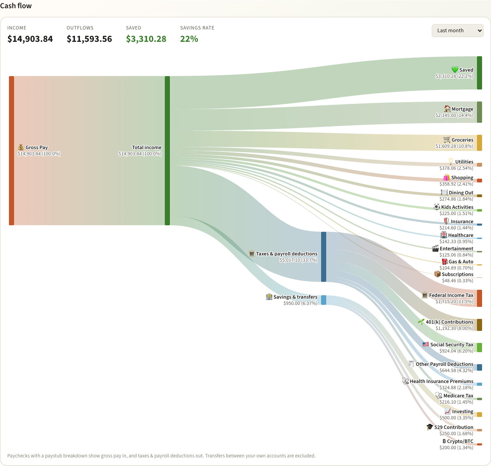
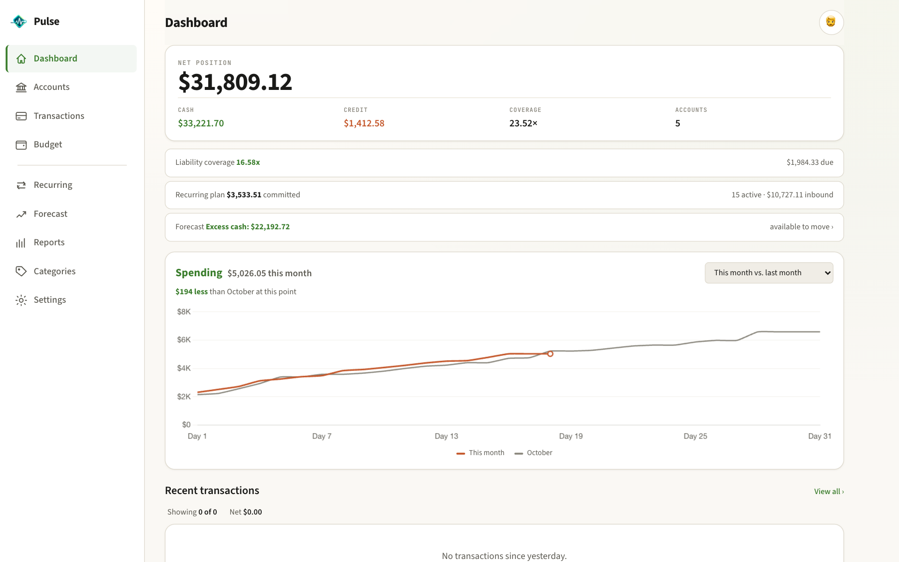
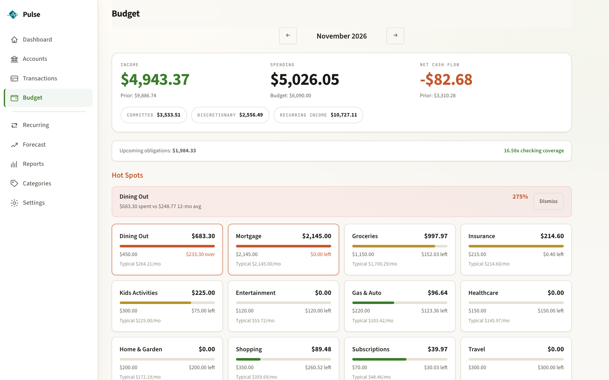
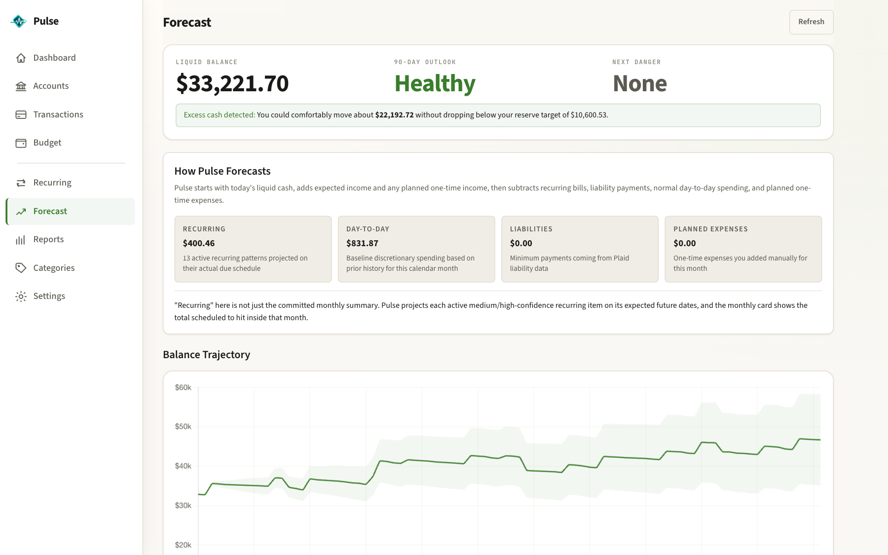
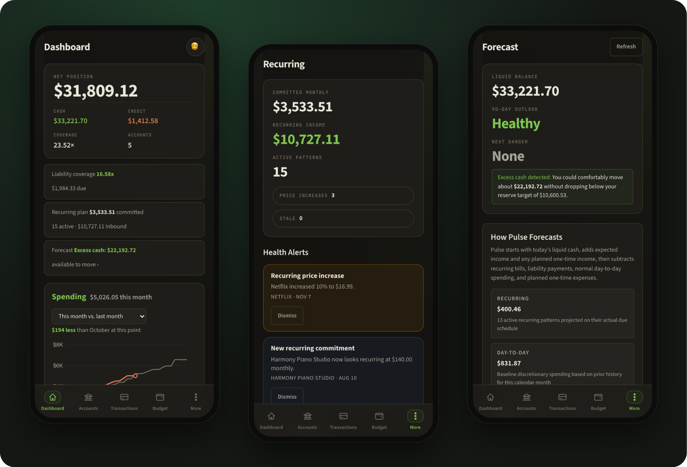

<div align="center">


# Family Pulse

**See where your household's money goes, on a server you own.**

Bank sync, budgets, recurring bills, a 90-day cash forecast, and a full cash-flow diagram for the whole family.
Self-hosted. No subscription. Your transactions stay in your own Postgres database.

[](LICENSE)     [](https://www.sovereignhome.org)

[Features](#features) · [Coming from Monarch?](#coming-from-monarch) · [Screenshots](#screenshots) · [Get started](#get-started) · [Privacy](#privacy-and-security) · [Docs](#documentation)

</div>

<br>

<picture>
  <source media="(prefers-color-scheme: dark)" srcset="docs/images/cash-flow-dark.png">
  
</picture>

<p align="center"><sub>Every dollar from gross pay to where it went. Taxes, 401(k), mortgage, groceries, and what you saved, in one picture.<br>Screenshots use a made-up demo household. No real accounts appear anywhere in this README.</sub></p>

## Why Family Pulse

Most budgeting apps are built for one person and rented by the month. Family Pulse is built for a household and runs on your hardware.

- **Built for families.** Parents see everything. Kids get their own "My Money" view, limited to their own accounts and allowance budget.
- **Your data stays home.** Plaid syncs into a Postgres database you control. No vendor cloud, no analytics.
- **It looks ahead.** Recurring-bill detection and a 90-day forecast show next month's tight spots before you reach them.
- **AI is optional.** Turn on Ask Pulse and what-if planning with your own API key. Without a key, nothing leaves the server.

## Features

<table>
<tr>
<td width="50%" valign="top">

### 🌊 Cash flow you can see
A Sankey diagram from income to every category, by month, quarter, or year. Add a paystub breakdown and it starts from **gross pay**, so federal tax, Social Security, Medicare, 401(k), and health premiums get their own flows.

</td>
<td width="50%" valign="top">

### 🎯 Budgets with hot spots
Set a budget for each category and track it through the month. **Hot Spots** flag a category running well above its 3- or 12-month average, such as dining out at 275% of normal, while you can still act.

</td>
</tr>
<tr>
<td valign="top">

### 🔁 Recurring radar
Finds subscriptions, bills, and paychecks without setup. Alerts when a **price goes up**, when a **new commitment** appears, or when **expected income** doesn't arrive. Lists everything due in the next 30 days.

</td>
<td valign="top">

### 🔮 90-day forecast
Projects your balance day by day from expected paychecks, scheduled bills, card payments, and normal spending, with a confidence band. Warns about **danger zones** below your safety floor and shows **excess cash** you could move.

</td>
</tr>
<tr>
<td valign="top">

### 👧 Kids' money view
Each kid signs in to a simple page with their balance, monthly budget, spending by category, and recent purchases. They see only their own accounts.

</td>
<td valign="top">

### 🧾 Transactions that remember
Split one charge across categories. Attach receipts and notes. Rename cryptic merchants. Rules and **learned auto-categorization** cover the routine ones. Transfers and duplicates are detected so nothing counts twice.

</td>
</tr>
<tr>
<td valign="top">

### 💳 Credit and loan coverage
Uses Plaid Liabilities to pull statement balances, minimum payments, and due dates, then shows how many times your checking balance covers what's due.

</td>
<td valign="top">

### ✨ Optional AI, your keys
**Ask Pulse** answers questions about your own data. **What-if** projects a scenario over 3, 6, and 12 months. A weekly digest and monthly close report are also available. A read-only **MCP server** lets your own AI client query balances, budgets, and cash flow.

</td>
</tr>
</table>

Also included: push reminders via [brrr](https://brrr.now) or a self-hosted gateway, CSV export of every transaction, balance history charts, and phone-friendly layouts throughout.

## Coming from Monarch?

Family Pulse began as one family's replacement for Monarch Money, so migrating is a built-in feature:

1. In Monarch, open **Settings → Export Data** and download your transactions CSV.
2. In Family Pulse, open **Import**, upload the file, and map Monarch's categories to yours. Suggestions are filled in for you.
3. Your history arrives categorized and deduplicated against anything Plaid has already synced.

Budgets, anomaly baselines, and trend charts work from day one because they have your full history. The Sankey view is included.

## Screenshots

**Dashboard**: net position, liability coverage, your recurring plan, and spending pace against last month.



**Budget**: category progress for the month, with Hot Spots for anything running well above normal.



**Forecast**: a 90-day balance trajectory with a confidence band, monthly outlook, and planned one-off expenses.



**On your phone**: dashboard, recurring alerts, and forecast.



<p align="center"><sub>Built for phones too, in light or dark mode. The Sankey is the one view that waits for a wide screen.</sub></p>

## Get started

You need your own [Plaid](https://plaid.com) developer account for bank sync. Plaid's Sandbox is free and works with test banks. Linking real banks requires Plaid production access.

### Option 1: Install with Home Base (recommended)

Family Pulse is part of **[The Sovereign Home](https://www.sovereignhome.org)**, a set of self-hosted family apps. [Home Base](https://github.com/eforbell/homeBase) installs it on a Debian or Ubuntu server, along with the database, the reverse proxy at `/pulse/`, and the systemd services. Then finish setup in the browser.

### Option 2: Run it yourself

Requirements: a current Node.js LTS and PostgreSQL. The included Docker Compose file runs Postgres for you.

```sh
git clone https://github.com/eforbell/familyPulse.git
cd familyPulse
docker compose up -d db          # Postgres on localhost:5434
cp .env.example .env             # add PLAID_CLIENT_ID, PLAID_SECRET, BOOTSTRAP_SECRET
npm install
node db/migrate.js
npm start                        # http://localhost:3003
```

Open the app and follow first-run setup to create your household. `BOOTSTRAP_SECRET` protects that first step. Then link your banks in **Settings**.

> [!TIP]
> Link credit cards, mortgages, and student loans with **Link Credit / Loan Account**. That flow requests Plaid Liabilities, so Pulse sees monthly payments rather than only the total balance.

## Privacy and security

- Plaid access tokens and API keys never appear in logs, API responses, or AI prompts. This is enforced in code (`lib/secrets-guard.js`, `lib/logger.js`).
- Parent and kid roles are checked on the server. Kids can only read accounts assigned to them.
- AI features are off until you add a key. When on, prompts carry aggregated context (balances, category totals, top merchants), never Plaid tokens or credentials.
- The MCP server is read-only and requires its own bearer token.

See [SECURITY.md](SECURITY.md) for the full data classification and threat model.

## Documentation

| Guide | What's in it |
| --- | --- |
| [Operator guide](docs/operator-guide.md) | Balance history, Plaid institution quirks, disconnect vs. purge, push verification, resetting linked data |
| [Data export](docs/data-export.md) | The enriched CSV export: what it includes and how to handle it safely |
| [AI planning access](docs/family-planning-access.md) | Read-only MCP/CLI access that combines Pulse cash flow with Helm investments |
| [Restore drill](planning/restore-drill.md) | A monthly check that your `pg_dump` backups restore |
| [Development](docs/development.md) | Project layout, local setup, the test database, and running tests |

## Contributing

Issues and pull requests are welcome. Start with [docs/development.md](docs/development.md): the test suite runs against a dedicated test database and refuses to touch your development data.

## License

[MIT](LICENSE)
